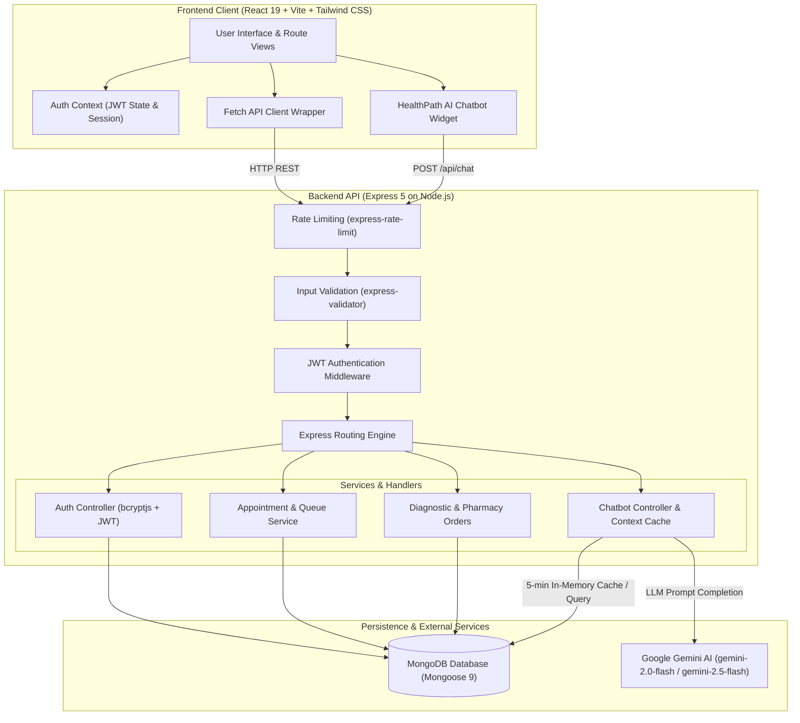

# System Architecture

HealthPath follows a decoupled client-server architecture designed for reliability, modularity, and rapid responsiveness. The application separates concerns across four distinct operational layers: Client Presentation, Backend API & Security, Persistence & Caching, and External AI Services.

---

## Architectural Overview

---

## Layer Breakdown

### 1. Client Presentation Layer (Frontend)
- **Framework & Bundler**: Built with React 19 and Vite 8 for fast Hot Module Replacement (HMR) and optimized static asset compilation.
- **Styling**: Tailwind CSS v4 provides utility-first responsive styling and clean modern UI components.
- **Routing & State**: React Router v7 manages application views. `AuthContext` maintains the current user's profile and JWT in browser `localStorage`, providing an authenticated `authFetch` wrapper across protected routes.
- **Interactive Widgets**: Includes a persistent `ChatBot` modal and a slide-over `AppointmentsSidebar` accessible across all pages.

### 2. API & Security Layer (Backend)
- **Runtime & Framework**: Node.js running Express 5.x.
- **Protection & Middleware**:
  - `express-rate-limit`: Throttles brute-force attempts on authentication (`/api/auth/*`) to 10 requests per 15 minutes, and restricts `/api/chat` to 10 requests per minute.
  - `express-validator`: Enforces strict schemas and data sanity checks on every incoming request before executing controllers.
  - `authMiddleware`: Verifies JSON Web Tokens (`Bearer <token>`) using `process.env.JWT_SECRET` and attaches decoded user claims (`id`, `name`, `email`) to `req.user`.

### 3. Persistence & Data Modeling Layer
- **Database**: MongoDB managed via Mongoose 9 schemas.
- **Integrity Enforcement**:
  - Enforces partial unique compound indexes on appointments (`doctorId`, `date`, `slot`) for active bookings to prevent race conditions and double-booking.
  - Re-queries canonical database pricing for lab tests on booking submissions rather than relying on client-supplied price figures.

### 4. External AI Integration & Fallback Engine
- **LLM Engine**: Google Gemini Generative AI via `@google/generative-ai`.
- **Directory-Infused Prompting**: Periodically aggregates registered hospitals and specialist doctors from MongoDB into a dynamic system prompt, cached in-memory with a 5-minute Time-To-Live (TTL).
- **Graceful Fallback**: If Gemini rate limits are hit or the API key is unconfigured, an internal keyword classification engine inspects user symptoms and suggests matching specialists and partner hospitals directly from MongoDB.
