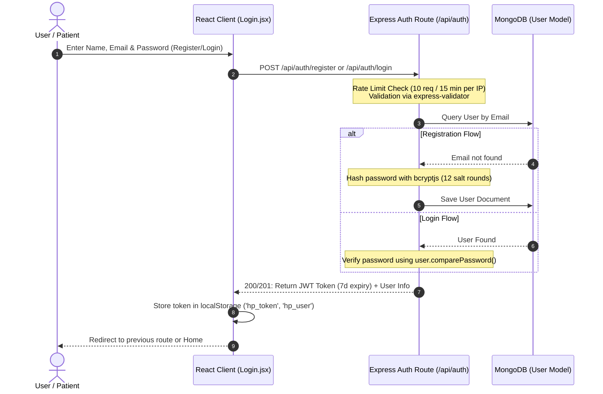
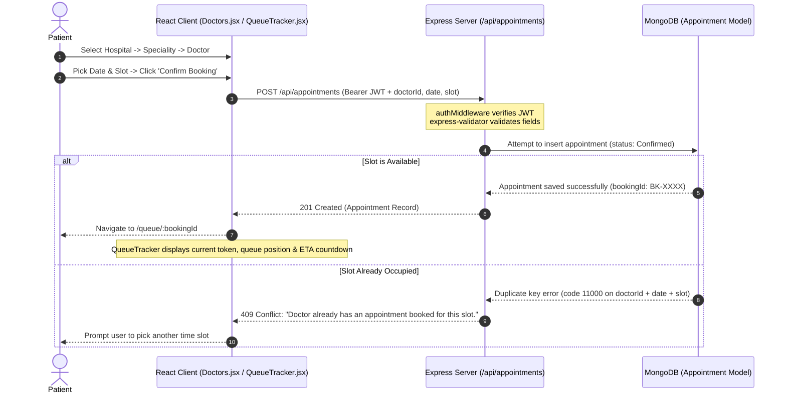
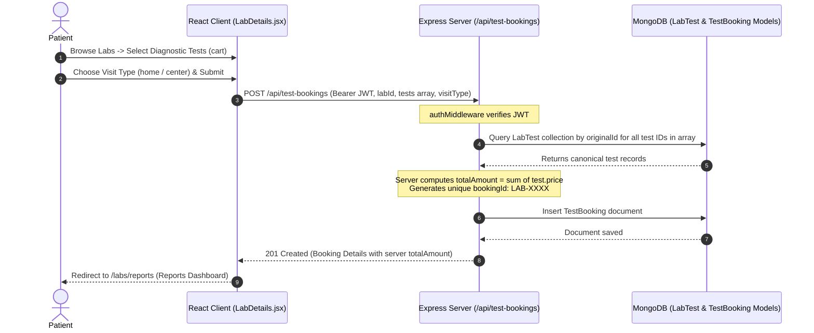
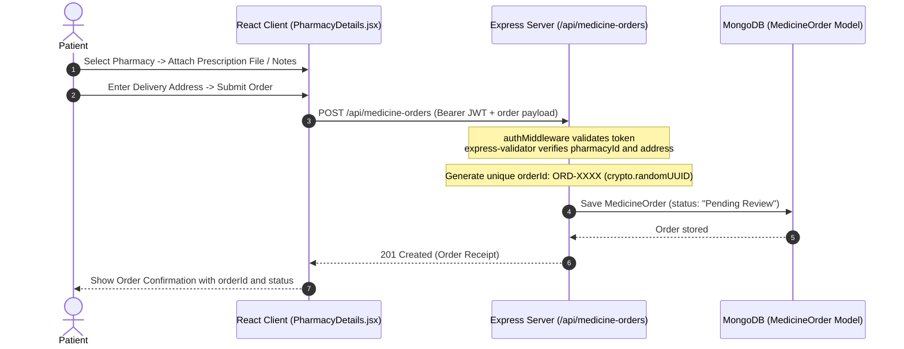
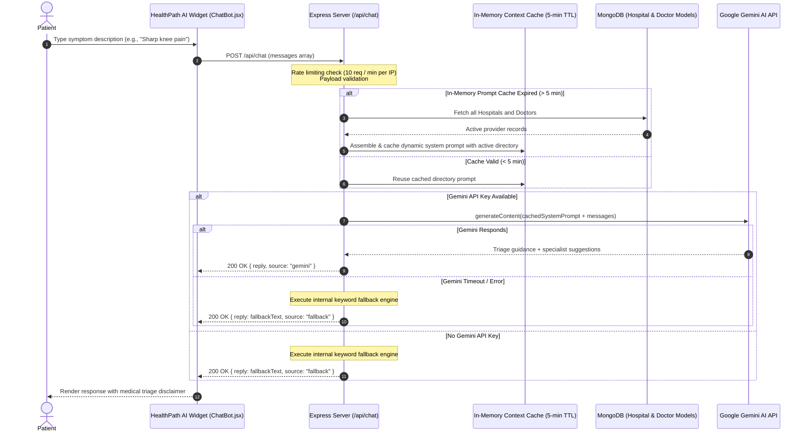
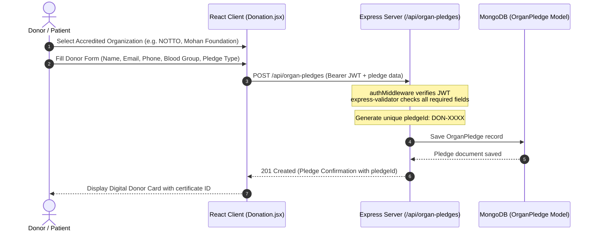

# Application Workflows

This document outlines the end-to-end sequences for core user journeys within HealthPath.

---

## Table of Contents
1. [User Authentication Flow](#1-user-authentication-flow)
2. [Doctor Appointment & Queue Tracker Flow](#2-doctor-appointment--queue-tracker-flow)
3. [Diagnostic Lab Booking Flow](#3-diagnostic-lab-booking-flow)
4. [Pharmacy Prescription & Medicine Order Flow](#4-pharmacy-prescription--medicine-order-flow)
5. [AI Health Assistant Consultation Flow](#5-ai-health-assistant-consultation-flow)
6. [Organ & Tissue Donation Pledge Flow](#6-organ--tissue-donation-pledge-flow)

---

### 1. User Authentication Flow

Handles user registration and credential-based login with IP-based rate limiting, schema validation, and salted password hashing.

---

### 2. Doctor Appointment & Queue Tracker Flow

Enables patients to browse hospitals, choose specialists, and book appointment slots with database-level conflict prevention and live queue tracking.

---

### 3. Diagnostic Lab Booking Flow

Enables patients to select lab tests, choose walk-in or home sample pickup, and prevents client-side price tampering by recalculating test amounts on the server.

---

### 4. Pharmacy Prescription & Medicine Order Flow

Supports prescription file uploads, home delivery details, and order tracking across partner pharmacies.

---

### 5. AI Health Assistant Consultation Flow

Provides contextual triage guidance powered by Google Gemini 2.0 Flash, dynamically loaded directory data from MongoDB, and an offline fallback engine.

---

### 6. Organ & Tissue Donation Pledge Flow

Enables donors to submit digital pledge commitments to accredited organ procurement organizations and receive a verifiable registration ID.

